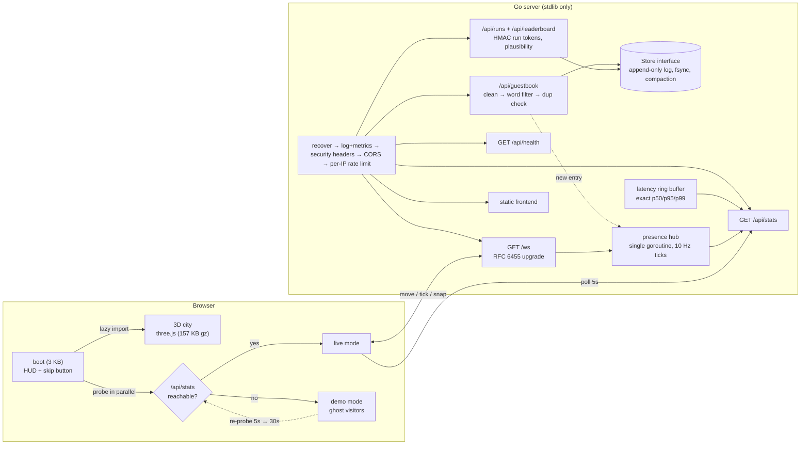

# The Living Server City

An interactive 3D portfolio for **Yashasvi Singh Rathore**: a miniature server city on a floating island at blue hour. Every building is a project, every moving light is a request, and the figures on the streets are other visitors connected to the site's own Go backend.

> **Recruiters:** **Skip to plain resume** is in the top-right corner of every screen, including the loading screen. The plain resume ([`/resume`](frontend/resume.html)) has the same content, loads without JavaScript, and prints cleanly.

## The experience

- **Boot log.** The loading screen reports what is actually happening (fonts, three.js import, baked city download, shader compile, the `/api/stats` probe), then the camera flies in from above the clouds.
- **Scroll tour.** Each project is a chapter. Scrolling flies the camera between landmarks, and the text column holds the summary, stack and three key facts.
  - **Watch a request** plays a real flow through that project's architecture, with each stop captioned.
  - **Read the write-up** opens the full architecture, tradeoffs and "what I would change".
- **Explore freely.** Hand the camera over (orbit, zoom, pan). Click any building to open its write-up. Click the pool table to take a shot.
- **Landmarks**, each with its own silhouette and behaviour:
  - **Queue Station (Mini-Sidekiq)** is a rail yard. Jobs are trains running the real flows: broker hall, a dispatcher signal blinking 3:2:1 like the queue weights, worker sheds with spinning fans, middleware gantries, a retry roundhouse, a scheduler clock tower and a red dead-letter buffer stop.
  - **Data Vault (Game Vault)** is a round vault door (Postgres) beside a Redis tower whose cache rings spin up on a hit. It also has an API office with one lamp per endpoint, the JWT gate, and a WebSocket mast that pulses when the leaderboard changes.
  - **Jetstrike Arena** is a stadium with circling jets and contrails. The **Gateway** at the south edge is where every request enters (auth and sessions).
  - **Pool Hall (8 Ball Masters)** has a pool table on the roof with real 2D ball physics: elastic collisions, cushions, pockets and friction.
  - **Arcade (Raging Bull)** has a rooftop runner where the bull jumps the bears.
  - **Lantern garden (guestbook):** every message becomes a lantern that rises from the pavilion and circles the island for everyone.
  - **Plaza hologram:** this server's live request count, p95 handler time, uptime and visitors online.
- **Traffic Defense (mini-game),** played in 3D on a deck that floats beside the island, joined to Main Street by a suspension bridge. Waves of traffic cross from the internet gate to a data centre with two origin servers and a bounded queue; failed requests burn an error budget. You build on fixed pads beside the road:
  - **Rate limiter:** a token bucket that drops bot bursts and lets normal users through.
  - **Cache:** answers GETs itself, with a hit ratio that rises as it warms up; heavy writes aren't cacheable.
  - **Load balancer:** adds servers with a short queue, but serves bot traffic too if nothing filtered it.

  Upgrades cost more each level, and every tower adds to a per-wave cloud bill. Scores go to a leaderboard backed by the Go server (signed single-use run tokens plus plausibility checks), or to this browser only in demo mode. The deck is modelled and baked with the rest of the city; towers, traffic, queue lamps and effects are live three.js on top. Pressing Play flies the camera to the deck (no page change), it works with mouse, touch or keyboard alone, and the game code loads only then.

## How the city is made

The island is modelled and lit **offline in Blender**, then shipped as one compressed glTF plus lightmaps. The browser draws it with a single unlit material, so the scene looks path-traced but costs almost nothing to render.

1. `frontend/src/world/layout.ts` is the map: roads on a 6-unit grid, district footprints, Mini-Sidekiq's station nodes. `npm run export-scene` writes it (plus every station track, routed exactly as the trains will drive them) to `tools/blender/scene.json`.
2. `tools/blender/build_city.py` builds the scene with Blender's Python API (`pip install bpy`): the island and cliff, the Kenney city tiles and buildings snapped to the grid (windows recoloured as lit or dark), street lamps, trees, and every landmark's static geometry. Everything shares one palette texture.
3. `tools/blender/bake.py` bakes Cycles irradiance (direct + bounced light, no albedo) into three lightmaps: ground (planar UVs, crisp shadows), structures (one packed chart per face) and nature. It exports geometry with two UV sets: palette colour and lightmap.
4. At runtime `src/world/city.ts` computes `palette × lightmap × exposure` and adds glow for window and neon cells from an emissive mask, which feeds the bloom pass.
5. Everything that moves is live three.js on top: trains, signal lamps, fans, clock hands, the vault door, cache rings, jets, pool balls, the bull, lanterns, avatars and request packets. Halos over the baked lamps flare as a request reaches each node.

`make city` re-runs the whole pipeline. On 2 CPU cores the bake takes about 25 minutes.

### Credits

- City tiles and buildings: [Kenney City Builder Starter Kit](https://github.com/KenneyNL/Starter-Kit-City-Builder) (models CC0, see `tools/blender/kenney/LICENSE.txt`). Thank you, Kenney.
- Look and technique studied from [Bruno Simon's folio-2025](https://github.com/brunosimon/folio-2025) (MIT): tinted rather than greyed shadows, a single palette texture for all models, restrained bloom, a blurred band at the frame edges. No models or code were copied.
- Baked-lightmap approach studied from Bruno Simon's [my-room-in-3d](https://github.com/brunosimon/my-room-in-3d) (MIT).

## Status

| Area | State |
|---|---|
| Island (Blender-baked), landmarks, scroll tour, explore mode | Done |
| Request flows | Mini-Sidekiq (3), Game Vault (3), Jetstrike (2) |
| Live presence, stats hologram, guestbook lanterns | Done (real backend) |
| Demo mode | Done: simulated ghosts, browser-only guestbook, honest "no backend" hologram |
| Tower-defense game + leaderboard | Done: game rules unit-tested, scores checked server-side, demo-mode board in the browser |

## Run it locally

Requirements: Go 1.24+, Node 22+. (Blender is only needed to change the city model; the baked result is committed.)

```bash
# 1. backend tests (incl. race detector)
make race

# 2. build the frontend and serve everything from the Go server on :8080
make build
make run                # open http://localhost:8080

# or: frontend hot-reload against a running backend
cd backend && go run ./cmd/server      # terminal 1, :8080
cd frontend && npm run dev             # terminal 2, proxies /api and /ws
```

With Docker:

```bash
docker compose up --build              # http://localhost:8080
```

## Editing content

All personal text lives in **[`frontend/src/config/site.config.ts`](frontend/src/config/site.config.ts)**: profile, links, experience, projects, architecture flows. Both the city and the plain resume read from it.

- Set unknown values to `TBD`. They're hidden on the site, and `npm run build` prints a list of every remaining TBD.
- The build **fails** if the file contains something that looks like an Indian mobile number, so a phone number can't ship by accident.
- Flow captions (`flows[].steps[].caption`) are what visitors read while a packet moves; each one should say what the real code does at that step.

## Architecture



### Backend design notes

- **No external modules.** The Go module proxy wasn't reachable when this was built, and the brief allowed a stdlib-only fallback. That meant writing the WebSocket layer by hand (`internal/wsock`): handshake, masking, 16/64-bit lengths, fragmentation with interleaved control frames, ping/pong, close codes 1002/1007/1009, UTF-8 validation, and a cap on declared payload size so a 14-byte header can't trigger a huge allocation. It is tested against the RFC's own handshake example and with raw frames.
- **Presence hub** (`internal/presence`): one goroutine owns all state, so there are no locks on the hot path. Moves are coalesced into one delta per client per 100 ms tick rather than broadcast as they happen (O(n²) messages). A client whose buffer is full skips a tick, gets flagged, and receives a full snapshot next tick; a periodic snapshot every 5 s self-heals anything missed. Slow clients cost bounded memory and never block the hub.
- **Abuse limits:** per-IP token bucket on `/api/*` and `/ws` (fails closed when its key map is full, to bound memory); max sockets per IP and in total; per-socket message bucket with a strike limit that ends in close code 1008; positions clamped to the map, NaN/Inf rejected, names sanitized to 16 runes; 1 KB max message; strict Origin check on upgrades. IPv6 clients are keyed by /64 so a host can't rotate addresses. Forwarding headers are trusted only when `CLIENT_IP_HEADER` is set, and X-Forwarded-For uses the right-most hop.
- **Stats:** exact percentiles over a ring buffer of the last 2,048 requests (sorted on read; cheap at this size, no bucket error). WebSockets are counted when they open but kept out of the latency window, since their lifetime isn't latency. The billboard says *handler time* because it is measured in-process and excludes network time.
- **Shutdown:** stop accepting requests, drain HTTP, stop the hub (every socket gets 1001 Going Away), wait for socket goroutines, then close the store. `http.Server.Shutdown` doesn't track hijacked connections, so the presence server keeps its own WaitGroup, and a socket can't register once shutdown has started.
- **Storage** (`internal/store`): handlers depend on a `Store` interface; the shipped implementation is an append-only JSON-lines log. Every write is fsynced before it's applied in memory, so an acknowledged write survives a crash. On start the log is replayed: a torn last line (crash mid-write) is truncated, a corrupt middle line is skipped and logged. When dead records (superseded scores, old entries) outnumber live data, it compacts to a temp file, fsyncs, and renames atomically. A SQLite or Postgres implementation only has to satisfy the interface.
- **Guestbook moderation** (`internal/moderation`): invisible and control characters (zero-width spaces, bidi overrides) are stripped, whitespace is collapsed, and length is counted in characters, not bytes. A word filter (English plus Hindi/Hinglish, in `wordlist.go`) undoes leetspeak (`sh1t`), stretched letters (`fuuuck`) and spacing (`f u c k`), while whole-word matching keeps "class", "Scunthorpe" and "therapist" clean. Links, all-caps shouting and repeated-character spam are rejected, and so is a message identical to one of the last 50. Writes are limited to 3 quick posts, then 1 every 20 s per IP. Requests must be `application/json`, so a cross-site HTML form can't post.
- **Leaderboard anti-cheat** (`internal/runs`): a game asks `POST /api/runs` for an HMAC-signed token at the start; the score submission must carry it. A token works once, expires after 2 h, is tied to its board, and can't claim more play time than really passed since it was issued. Scores must also be plausible for the wave reached (`BoardRules` in `internal/api/community.go`). A browser game can't be made fully cheat-proof, but these checks block replayed and hand-made submissions.

### What works where

| Feature | Self-hosted backend | Static host / single-file demo |
|---|---|---|
| City, districts, write-ups, animated flows | ✓ | ✓ |
| Plain resume | ✓ (`/resume`) | ✓ (`#resume` in single file) |
| Other visitors | Real people, live | Simulated ghosts, labelled as such |
| Billboard | Live server figures | "Offline demo" (no fake numbers) |
| Guestbook | Stored on the server, shared live with everyone | Saved in that browser only, and the panel says so |
| Traffic Defense game | ✓ | ✓ |
| Leaderboard | Shared, server-checked, updates live when anyone sets a best | Saved in that browser only, and labelled so |

## API

| Method | Path | Notes |
|---|---|---|
| GET | `/api/health` | `{"ok":true,"version":…}` |
| GET | `/api/stats` | Requests served, p50/p95/p99 handler time, uptime, visitors online |
| GET | `/ws` | Presence WebSocket (`move`, `name` in; `welcome`, `tick`, `snap`, `gb`, `lb` out) |
| GET | `/api/guestbook?limit=30` | Newest first, max 100 |
| POST | `/api/guestbook` | `{"name"?, "message"}`. 201, or 422 with `{"error","field"}`, 409 duplicate, 429 too fast |
| POST | `/api/runs` | `{"board":"defense"}` returns a single-use token |
| POST | `/api/leaderboard` | `{"board","name","score","wave","durationMs","token"}` returns `{rank, improved, best}` |
| GET | `/api/leaderboard?board=defense&limit=20` | Best score per name, highest first |

## Configuration (environment)

| Variable | Default | Purpose |
|---|---|---|
| `ADDR` | `:8080` | Listen address |
| `STATIC_DIR` | *(unset)* | Serve the built frontend from this directory |
| `ALLOWED_ORIGINS` | *(same-origin only)* | Comma-separated origins allowed for CORS and WebSocket upgrades, e.g. `https://yashasvi.dev` |
| `CLIENT_IP_HEADER` | *(socket address)* | Trusted header for the client IP: `Fly-Client-IP`, or `X-Forwarded-For` behind your own proxy. Leave unset if nothing in front of the server sets it |
| `RATE_RPS` / `RATE_BURST` | `10` / `40` | Per-IP limit for `/api/*` and `/ws` |
| `WS_MAX_PER_IP` / `WS_MAX_TOTAL` | `4` / `500` | Concurrent socket limits |
| `LOG_LEVEL` | `info` | `debug` also logs the polled `/api/stats` and `/api/health` |
| `SHUTDOWN_TIMEOUT` | `10s` | Graceful shutdown budget |
| `DATA_DIR` | `data` | Where the guestbook/leaderboard log lives. `memory` keeps nothing on disk |
| `RUN_SECRET` | *(random per start)* | HMAC key for game-run tokens. Set a long random string (`openssl rand -hex 32`) so games in progress survive a restart. Never commit it |

Developer scene lab: `npm run dev`, then open `/lab.html?cam=x,y,z,tx,ty,tz&flow=mini-sidekiq:0` to frame and screenshot any part of the island.

Frontend build variable: `VITE_API_BASE` (e.g. `https://city-api.fly.dev`) when the frontend is hosted separately from the backend.

## Deploy

**Free setup (recommended):** website on Cloudflare Pages, Go backend on a Google Cloud free-tier e2-micro behind Caddy, with a DuckDNS hostname. Step-by-step: [`deploy/DEPLOY.md`](deploy/DEPLOY.md); server setup script: [`deploy/gcp/setup.sh`](deploy/gcp/setup.sh). The options below remain for paid or self-managed hosting.

Nothing has been deployed. Each option below needs your accounts.

### Option A: Fly.io (whole site, one machine)

```bash
fly launch --copy-config --no-deploy     # edit `app` in fly.toml first
fly volumes create city_data --size 1 --region bom
fly secrets set RUN_SECRET=$(openssl rand -hex 32)
fly deploy
fly scale count 1                         # presence lives in memory: keep one machine
```

The machine sleeps when idle (`auto_stop_machines`). The first visitor after a sleep waits a second or two; the frontend retries the backend for that window instead of dropping into demo mode.

### Option B: a cheap VPS (Docker + Caddy for HTTPS)

```bash
# on the server
git clone <this repo> city && cd city
docker compose up -d --build
```

Put Caddy in front for TLS (`/etc/caddy/Caddyfile`):

```
yourdomain.com {
    reverse_proxy localhost:8080
}
```

Data lives in the `city-data` Docker volume; back it up with `docker compose cp city:/data/site.log ./backup-site.log`.

Then set `CLIENT_IP_HEADER: X-Forwarded-For` in `docker-compose.yml` (Caddy appends the real client IP) and restart. Don't publish port 8080 to the internet when Caddy is in front: change it to `"127.0.0.1:8080:8080"`.

### Option C: static frontend + backend elsewhere

```bash
cd frontend
VITE_API_BASE=https://your-backend.example npm run build   # upload dist/ to Netlify, Cloudflare Pages, GitHub Pages…
```

Set `ALLOWED_ORIGINS=https://your-static-site.example` on the backend. Without a backend, the static site runs in demo mode.

### Option D: one HTML file

`npm run build:single` writes `frontend/dist-single/index.html` (everything inlined, fonts included). It always runs in demo mode.

## Performance

Measured on this build (`npm run build`). The Go server sends the precompressed `.gz` copies that the build writes next to each JS, CSS and model file.

| Asset | Size | Sent over the wire |
|---|---|---|
| `index.html` + boot JS + CSS (top bar, resume button, loader) | 22 KB | ~8 KB |
| 3D code (three.js, postprocessing, world, experience), lazy-loaded | 932 KB | 276 KB |
| Baked city model `city.glb` (meshopt-compressed geometry, per-corner light) | 1.51 MB | ~0.8 MB |
| Lightmaps: ground 2048² + cliffs/trees 1024² (JPEG) | 848 KB | 848 KB |
| Palette + emissive mask (PNG) | 16 KB | 16 KB |
| Fonts: Unbounded (variable) + IBM Plex Sans 400/600 + Plex Mono, latin woff2 | 112 KB | 112 KB |
| `resume.html` + CSS (no JS) | 21 KB | ~8 KB |
| Single-file build (everything inlined, demo mode) | 4.3 MB | 2.2 MB gzipped |

About 2 MB in total before the city is interactive. The plain resume never waits for any of it.

Rendering: the city is one unlit material (palette × baked light + emissive glow), so its cost barely depends on how much is lit. On top: ACES tone mapping, mipmap bloom (half resolution on phones), a tilt-shift blur band at the top and bottom of the frame on desktop, vignette and film grain. No real-time shadows. Phones get a lighter tier: 1.25× pixel ratio, no tilt-shift, no anti-aliasing pass, fewer jets and trains. The renderer drops to 1× resolution if it can't hold about 28 fps. `prefers-reduced-motion` stops pointer parallax and camera flights (the camera cuts between chapters), and flows step between nodes instead of travelling. `?quality=low|high` forces a tier.

Headless checks (this sandbox has no GPU, so Chromium renders WebGL on the CPU with SwiftShader):

| Check | Result |
|---|---|
| Phone emulation (390×844, 4× CPU throttle, 9 Mbps / 150 ms): **Skip to plain resume clickable** | **0.7 s** |
| Same: city interactive | 5.9 s (baked city download 2.0 s, shader compile 1.7 s in software) |
| Frame rate, phone emulation / desktop | 17 fps / 10–11 fps in software rendering |

The software-rendering numbers are a floor, not a forecast. Real GPUs compile shaders in parallel and render this scene far faster, but **I could not measure a real phone here**. Checking load time and fps on a mid-range Android is still open.

## Tests

```bash
cd backend && go test -race -count=1 ./...
cd frontend && npm test        # Traffic Defense rules (node:test)
```

The game tests cover tower placement rules, upgrade and sell accounting, the cloud bill, the token bucket never dropping more than its tokens allow, cache warm-up, a run ending when the error budget runs out, and that every reachable score stays inside the server's plausibility check (score per wave, minimum time per wave).

Covers the WebSocket codec and handshake (RFC test vector, every frame-validation rule, fragmentation, oversize and invalid UTF-8 closes, origin/version/key rejection); the presence hub (join/move/rename/leave, clamping and sanitizing, per-IP limit, flood disconnect, slow-consumer snapshot recovery, shutdown closing every socket); the rate limiter (refill, burst cap, memory bound, concurrency); percentiles; the HTTP layer (stats accounting, 429 with Retry-After, CORS, WS origin check, client-IP resolution table, panic recovery, static serving and path traversal); the store (persistence across reopen, torn-write recovery, corrupt-line skipping, best-score-per-name with tie-breaks, retention, compaction, concurrent writers); moderation (cleaning, blocked words incl. evasions, innocent words that contain blocked substrings, links and spam); run tokens (tampering, forgery, replay, expiry, impossible play time, concurrent double-redeem); and the guestbook and leaderboard endpoints end to end, including live broadcast to sockets.

## Layout

```
backend/
  cmd/server/          main: config, graceful shutdown, `healthcheck` subcommand
  internal/wsock/      RFC 6455 server (+ wstest: tiny masking client for tests)
  internal/presence/   hub + socket server
  internal/ratelimit/  keyed token buckets
  internal/metrics/    request counter + latency window
  internal/api/        routes, middleware, client IP, static files, guestbook + leaderboard
  internal/store/      Store interface + append-only file store
  internal/moderation/ text cleaning, word filter (wordlist.go is editable)
  internal/runs/       signed single-use game-run tokens
  internal/config/     env config
frontend/
  src/config/          site.config.ts  ← all personal content (incl. architecture flows)
  src/resume/          prerendered plain resume
  src/net/             backend client, reconnect, demo-mode ghosts, guestbook + leaderboard clients
  src/world/           stage (renderer, post, sky), baked city loader, layout (the map),
                       trains, courier packets, halos, avatars
  src/assets/city/     baked city: city.glb (meshopt), lightmaps, palette, emissive mask
  src/world/landmarks/ station, vault, arena + gateway, pool hall, arcade, plaza + garden
  src/experience/      loader, chapters, camera rig (tour/fly/explore), 3D labels, app
  src/game/            Traffic Defense: sim.ts (rules, tested), deck3d.ts (3D layer), defense.ts (HUD + input)
  src/ui/              styles, self-hosted fonts, guestbook form
  scripts/             export-scene.ts (map -> Blender)
tools/blender/         build_city.py (model the city), bake.py (lightmaps + export), kenney/ (CC0 assets)
```
